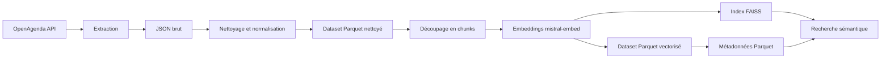

# Fonctionnement du système RAG d'événements culturels

Ce projet collecte des événements culturels depuis OpenAgenda, les nettoie, les transforme en représentations vectorielles, puis les indexe avec FAISS afin de permettre une recherche sémantique.

Le pipeline traite les événements situés dans les départements suivants :

- Côtes-d'Armor
- Finistère
- Ille-et-Vilaine
- Morbihan
- Loire-Atlantique

La collecte couvre une période allant d'un an dans le passé à un an dans le futur et recherche les événements liés aux concerts.

## Vue d'ensemble



Le pipeline de préparation est orchestré par `src/main.py`. Le chatbot Streamlit est lancé avec `src/chat.py` et la logique RAG est regroupée dans `src/rag.py`.

## Prérequis

- Python 3.13 ou version ultérieure
- Une clé API OpenAgenda avec accès à la lecture transverse
- Une clé API Mistral
- Les dépendances listées dans `requirements.txt`, notamment LangChain et `langchain-mistralai`

## Installation

Depuis la racine du projet :

```bash
python -m venv venv
```

Sous Windows PowerShell :

```powershell
.\venv\Scripts\Activate.ps1
```

Sous macOS ou Linux :

```bash
source venv/bin/activate
```

Installer ensuite les dépendances :

```bash
pip install -r requirements.txt
```

Créer un fichier `.env` à la racine du projet :

```dotenv
OPENAGENDA_KEY=votre_cle_openagenda
MISTRAL_API_KEY=votre_cle_mistral
```

Les variables sont chargées automatiquement par `src/config.py` avec `python-dotenv`.

## Exécution complète

Lancer le pipeline depuis la racine :

```bash
python src/main.py
```

Les étapes sont exécutées dans l'ordre suivant :

1. Récupération des événements OpenAgenda.
2. Écriture des données brutes au format JSON.
3. Nettoyage et dédoublonnage des événements.
4. Découpage des textes en morceaux de taille limitée.
5. Création des embeddings avec le modèle `mistral-embed`.
6. Construction de l'index vectoriel FAISS.
7. Écriture des métadonnées associées aux vecteurs.
8. Affichage d'un bilan par département et par statut temporel.

Les répertoires de sortie sont créés automatiquement lorsqu'ils n'existent pas.

Cette commande doit être exécutée avant le chatbot si l'index FAISS n'existe pas encore ou si les données doivent être actualisées.

## Étape 1 : extraction OpenAgenda

Le module `src/extract.py` appelle l'endpoint :

```text
https://api.openagenda.com/v2/events
```

La requête :

- demande des événements en français ;
- récupère les descriptions détaillées et les labels ;
- filtre les événements dont le terme de recherche est `Concert` ;
- limite la zone géographique aux cinq départements configurés ;
- récupère les événements compris entre `HISTORY_DAYS` et `FUTURE_DAYS` ;
- utilise une pagination pour récupérer toutes les pages disponibles.

Les réponses sont contrôlées. Une erreur HTTP ou une réponse ne contenant pas la clé `events` interrompt le pipeline.

Le résultat est enregistré dans :

```text
data/raw/agendas.json
```

## Étape 2 : nettoyage et normalisation

Le module `src/clean.py` transforme chaque événement OpenAgenda en un schéma stable. Les champs principaux sont :

- identifiant de l'événement ;
- titre et description ;
- dates de début et de fin ;
- ville, département, lieu et adresse ;
- mots-clés ;
- coordonnées géographiques ;
- URL et image.

Les descriptions et certains champs textuels sont nettoyés : les balises HTML sont supprimées, les entités HTML sont décodées et les espaces sont normalisés.

Les événements sans identifiant ou sans date de début sont écartés. Les doublons sont supprimés avec la combinaison `event_id` et `date_start`.

La colonne `is_upcoming` indique si la date de début est aujourd'hui ou ultérieure.

Le dataset nettoyé est enregistré dans :

```text
data/clean/agendas.parquet
```

## Étape 3 : découpage et vectorisation

Le module `src/embed.py` choisit en priorité la description comme texte de recherche. Si la description est absente, le titre est utilisé.

Chaque texte est découpé en morceaux :

- taille maximale : `1000` caractères ;
- chevauchement : `150` caractères ;
- respect autant que possible des limites entre les mots.

Chaque morceau reçoit un identifiant de la forme :

```text
<event_id>_<numero_du_chunk>
```

Le texte est envoyé à l'API Mistral par lots de 64 éléments avec le modèle `mistral-embed`. Les embeddings sont stockés dans la colonne `embedding`.

Le dataset vectorisé n'est pas persisté séparément. Les embeddings sont transmis
directement à `vector_store.build_index`, qui écrit uniquement l'index FAISS et
les métadonnées sans la colonne `embedding`.

## Étape 4 : indexation FAISS

Le module `src/vector_store.py` ignore les lignes dépourvues d'embedding, convertit les vecteurs en `float32`, puis les normalise avec `faiss.normalize_L2`.

L'index utilisé est `faiss.IndexFlatIP`. Après normalisation, le produit scalaire correspond à une similarité cosinus.

Deux fichiers sont produits :

```text
data/vector_store/events.faiss
data/vector_store/metadata.parquet
```

L'ordre des lignes dans `metadata.parquet` correspond à l'ordre des vecteurs dans l'index FAISS. Cette correspondance permet de retrouver les informations de l'événement après une recherche.

Le programme vérifie que tous les chunks du dataset ont pu être indexés. Si le nombre de vecteurs indexés est inférieur au nombre de chunks, il lève une erreur.

## Recherche sémantique

La fonction `vector_store.search` permet de rechercher les événements les plus proches d'une question ou d'une expression :

```python
from pathlib import Path

import vector_store

results = vector_store.search(
    query="concert de musique classique en Bretagne",
    index_file=Path("data/vector_store/events.faiss"),
    metadata_file=Path("data/vector_store/metadata.parquet"),
    limit=5,
)

print(results[["score", "title", "city", "date_start", "url"]])
```

La fonction :

1. charge l'index FAISS ;
2. charge les métadonnées Parquet ;
3. vectorise la requête avec `mistral-embed` ;
4. recherche les vecteurs les plus proches ;
5. renvoie un `DataFrame` contenant le score et les métadonnées des chunks trouvés.

## Génération de réponse avec le RAG

Le module `src/rag.py` ajoute la génération de réponse au-dessus de la recherche vectorielle :

1. `retrieve` appelle `vector_store.search` et récupère les trois chunks les plus proches pour le chatbot.
2. Chaque résultat est converti en document LangChain contenant le titre, la date, la ville, le lieu, la description et l'URL.
3. Un `ChatPromptTemplate` transmet les documents et la question au modèle de chat Mistral.
4. `ChatMistralAI` utilise le modèle `open-mistral-nemo` avec une température nulle.
5. `StrOutputParser` convertit la réponse du modèle en texte.

Le prompt demande une réponse en français, concise et factuelle. Le modèle doit utiliser exclusivement le contexte récupéré, ne pas inventer d'événement, de date, de lieu ou d'URL, et signaler clairement lorsqu'aucune information ne permet de répondre.

La fonction principale est :

```python
from rag import answer

print(answer("Quels concerts sont proposés à Rennes ?"))
```

L'historique des questions n'est pas conservé : chaque appel à `answer` est indépendant.

## Utilisation du chatbot

Après avoir construit l'index avec `python src/main.py`, lancer l'interface Streamlit depuis la racine :

```bash
streamlit run src/chat.py
```

L'interface affiche les messages avec les composants de conversation Streamlit et conserve l'historique pendant la session.

Le chatbot nécessite donc les deux types d'accès suivants :

- l'accès aux fichiers FAISS et Parquet générés dans `data/vector_store/` ;
- une clé Mistral valide, utilisée à la fois pour vectoriser les requêtes et pour générer les réponses.

## Organisation des fichiers générés

```text
data/
├── raw/
│   └── agendas.json
├── clean/
│   └── agendas.parquet
├── evaluation/
│   └── questions.jsonl
└── vector_store/
    ├── events.faiss
    └── metadata.parquet

src/
├── chat.py
├── clean.py
├── config.py
├── embed.py
├── extract.py
├── main.py
├── rag.py
└── vector_store.py

tests/
└── test_vector_data.py
```

Ces fichiers sont des artefacts générés. Ils peuvent être recréés en relançant le pipeline, mais leur production nécessite des appels aux API OpenAgenda et Mistral.

## Configuration principale

Les paramètres sont centralisés dans `src/config.py` :

| Paramètre | Rôle | Valeur actuelle |
| --- | --- | --- |
| `HISTORY_DAYS` | Nombre de jours d'historique | `365` |
| `FUTURE_DAYS` | Nombre de jours à venir | `365` |
| `EMBED_MODEL` | Modèle d'embedding Mistral | `mistral-embed` |
| `EMBED_BATCH` | Taille des lots d'embeddings | `16` |
| `CHUNK_SIZE` | Taille maximale d'un chunk | `1000` |
| `CHUNK_OVERLAP` | Chevauchement entre chunks | `150` |
| Modèle de chat | Modèle utilisé pour les réponses | `open-mistral-nemo` |

## Évaluation et tests

Le fichier `data/evaluation/questions.jsonl` peut contenir les questions de référence du projet. Chaque ligne prévoit les champs `question`, `expected_answer`, `expected_event_ids` et `notes`.

Les réponses attendues et les identifiants d'événements doivent être vérifiés après une reconstruction de l'index, car les événements OpenAgenda peuvent évoluer.

Les tests `tests/test_vector_data.py` et `tests/test_vector_store.py` vérifient
l'intégrité de l'index généré :

- le nombre de métadonnées correspond au nombre de vecteurs FAISS ;
- les champs essentiels sont renseignés ;
- les départements appartiennent à la liste configurée ;
- les dates restent dans la fenêtre d'un an avant à un an après la date courante.
- les vecteurs sont normalisés et la recherche conserve l'alignement avec les
  métadonnées ;
- les erreurs d'index absent ou vide sont explicites.

Les tests unitaires de nettoyage et de découpage sont également exécutés avec :

```bash
python -m pytest -q
```

Si l'index n'a pas encore été construit, les tests qui dépendent de la base
sont ignorés avec un message explicite. Il faut alors lancer `python src/main.py`
avant de relancer la vérification complète.

## Limites actuelles

- Le chatbot est une interface Streamlit ; aucun endpoint dédié n'est fourni.
- La clé OpenAgenda doit disposer de l'accès nécessaire à la lecture transverse.
- La collecte et la vectorisation dépendent de la disponibilité des deux API externes.
- Les embeddings sont recalculés à chaque exécution complète du pipeline.
- La recherche renvoie des chunks et leurs métadonnées ; le regroupement de plusieurs chunks appartenant au même événement n'est pas réalisé automatiquement.
- Le chatbot ne conserve pas l'historique de la conversation.
- La qualité des réponses dépend des quatre événements au maximum transmis au
  modèle et de la qualité des données collectées.

## Dépannage rapide

### Aucun événement retourné

Vérifier la clé `OPENAGENDA_KEY`, son niveau d'accès, les départements configurés et la période de collecte.

### Erreur d'authentification Mistral

Vérifier que `MISTRAL_API_KEY` est bien défini dans `.env` et que la clé est active.

### Aucun embedding disponible

Vérifier que le dataset nettoyé contient des titres ou des descriptions non vides. L'index FAISS ne peut pas être construit sans embedding.

### Répertoire `data` absent

Ce n'est pas bloquant : les modules créent automatiquement les répertoires nécessaires avant d'écrire leurs résultats.

### Index absent au lancement du chatbot

Construire d'abord la base vectorielle :

```bash
python src/main.py
```

Puis relancer :

```bash
streamlit run src/chat.py
```
