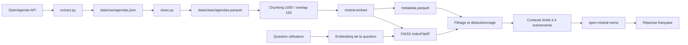

# Puls-Events — Rapport d'architecture et de résultats du POC RAG

**Projet :** système de recherche et de recommandation d'événements culturels  
**Périmètre :** cinq départements de l'Ouest, événements de type concert  
**Version observée :** état du dépôt au 21 octobre 2026  
**Nature du document :** livrable d'architecture, choix techniques, évaluation et recommandations

## 1. Résumé exécutif

Le projet Puls-Events est un prototype de moteur de recherche conversationnel
consacré aux événements culturels. Son objectif est de permettre à un utilisateur
de poser une question en français, par exemple « Quel concert est prévu à Brest
en novembre ? », puis d'obtenir une réponse factuelle à partir d'un agenda
OpenAgenda.

Le choix d'une architecture **RAG (Retrieval-Augmented Generation)** répond à
deux contraintes importantes. Premièrement, les événements sont des données
changeantes : les dates, lieux et URLs ne doivent pas être mémorisés dans les
poids d'un modèle généraliste. Deuxièmement, le système doit pouvoir refuser une
question hors périmètre plutôt que produire une recommandation plausible mais
fausse. Le modèle génératif ne reçoit donc que les événements récupérés dans
l'index, avec une consigne explicite de ne rien inventer.

Le pipeline actuel est organisé en cinq étapes :

1. collecte paginée de données OpenAgenda ;
2. nettoyage, dédoublonnage et contrôle de la fenêtre temporelle ;
3. découpage des descriptions et calcul d'embeddings Mistral ;
4. indexation des vecteurs dans FAISS et conservation des métadonnées dans
   Parquet ;
5. récupération des événements pertinents puis génération d'une réponse par
   `open-mistral-nemo` via LangChain.

L'état évalué contient **1 633 événements**, dont **493 à venir** et **1 140
passés**, répartis sur **2 179 chunks**. Ces données ont été extraites le
**14 octobre 2026** à partir de l'API officielle OpenAgenda avec une vraie clé
API disposant du rôle « lecture transverse » ; elles ne proviennent donc pas du
dataset statique OpenAgenda du 8 avril 2024 fourni comme support dans l'exercice.
Le jeu d'évaluation comporte 12
questions, dont 8 avec un événement attendu. Le système récupère l'identifiant
attendu dans **6 cas sur 8**, soit un hit@k de **75 %** sur ce sous-ensemble.
Les tests automatisés sont tous passants (**21/21**).

Le POC valide donc la faisabilité technique de la chaîne complète, mais ne doit
pas encore être considéré comme un moteur de recommandation final. Les principaux
chantiers sont l'amélioration du filtrage structuré (ville, département, date,
genre), la calibration d'un seuil de confiance, la constitution d'un jeu de
vérité terrain plus large et la mise en place d'un rafraîchissement contrôlé des
données.

## 2. Besoin fonctionnel et périmètre

### 2.1 Problème traité

Les agendas culturels contiennent de nombreuses informations hétérogènes :
titres, descriptions HTML, créneaux multiples, lieux, villes et URLs. Une
recherche uniquement lexicale est fragile lorsque la question reformule le
contenu de l'événement. À l'inverse, une génération directe par un LLM risque
d'inventer une date ou de mélanger deux événements.

Le POC vise donc une réponse qui respecte les propriétés suivantes :

- être formulée en français ;
- s'appuyer uniquement sur des événements présents dans la base ;
- restituer au minimum le titre, la date, le lieu et l'URL lorsqu'ils sont
  disponibles ;
- ne conserver par défaut que les événements à venir ;
- répondre explicitement lorsqu'aucun événement fiable n'est trouvé ;
- couvrir les départements Côtes-d'Armor, Finistère, Ille-et-Vilaine, Morbihan
  et Loire-Atlantique ;
- couvrir une fenêtre d'un an dans le passé et d'un an dans le futur au moment
  de la collecte.

Le choix actuel de `SEARCH_QUERY = "Concert"` restreint le POC aux événements
correspondant à ce terme dans OpenAgenda. Il s'agit d'un périmètre volontairement
réduit pour valider le fonctionnement de la recherche sémantique avant
d'étendre la couverture à d'autres catégories culturelles.

### 2.2 Hors périmètre du POC

Le POC ne gère pas encore l'historique de conversation, l'authentification, la
réservation, la personnalisation par profil, la détection automatique de tous
les filtres exprimés en langage naturel ou une mise à jour temps réel. Les
filtres `city`, `date_from` et `date_to` existent dans l'API Python de
récupération, mais le chatbot ne les extrait pas automatiquement de la question.

## 3. Architecture du système

### 3.1 Vue d'ensemble

L'architecture sépare clairement la phase **offline** de construction de l'index
et la phase **online** de réponse :

- `src/main.py` orchestre la collecte, le nettoyage, la vectorisation et
  l'indexation ;
- `src/chat.py` fournit une interface conversationnelle Streamlit ;
- `src/rag.py` regroupe la récupération et la génération ;
- `src/vector_store.py` encapsule FAISS et l'alignement entre vecteurs et
  métadonnées.

Cette séparation est adaptée à un POC : la base peut être reconstruite sans
modifier la logique de conversation, et l'index est réutilisable entre deux
questions.

### 3.2 Flux de préparation des données

`extract.py` appelle directement la route officielle de lecture transverse
`GET /v2/events` d'OpenAgenda, et non un export ou le dataset statique daté du
8 avril 2024 mentionné dans l'exercice. L'accès repose sur une clé API réelle
autorisée par le rôle complémentaire **« lecture transverse »**. Ce rôle permet
de lister les événements récents et à venir publiés sur des agendas publics
indexés sur OpenAgenda. Une authentification en lecture ou par jeton d'accès est
requise pour cette route après contact avec le support.

La requête demande une réponse en français, une description détaillée, les cinq
départements, une fenêtre de ±365 jours et la recherche « Concert ». La
pagination est parcourue jusqu'à épuisement et les identifiants `uid` sont
utilisés pour écarter les doublons éventuels entre pages. La collecte ayant
servi aux résultats de ce rapport a été réalisée le **14 octobre 2026**.
OpenAgenda précise que les événements passés sont régulièrement retirés de
l'index transverse ; une collecte ultérieure peut donc produire un périmètre
différent, même avec les mêmes paramètres.

Chaque événement OpenAgenda est également diffusé sous une licence indiquée par
la clé `rights`. Toute réutilisation dans la version finale devra conserver cette
information, respecter les conditions de la licence associée et afficher les
mentions ou liens nécessaires. Le POC conserve l'URL de l'événement, mais devra
prévoir une gestion explicite de `rights` dans son schéma de production.

Les appels HTTP bénéficient d'un délai minimum et de réessais progressifs sur
les erreurs 429 et 5xx.

`clean.py` convertit ensuite les événements dans un schéma stable : identifiant,
titre, description, dates, ville, département, lieu, adresse, URL et indicateur
`is_upcoming`. Les balises HTML sont retirées, les entités sont décodées et les
espaces sont normalisés. Pour un événement avec plusieurs créneaux, le prochain
créneau à venir dans la fenêtre est privilégié ; à défaut, le créneau passé le
plus récent est conservé. Cette règle évite qu'un ancien créneau hors fenêtre
devienne la date représentative de l'événement.

Le contrôle qualité vérifie notamment que le jeu n'est pas vide, que les dates
sont dans la fenêtre, que les départements sont autorisés et que les titres et
dates essentielles sont renseignés. En cas de problème, `main.py` arrête le
pipeline plutôt que de construire silencieusement un index incomplet.

### 3.3 Chunking et embeddings

Le texte à vectoriser est la description longue lorsqu'elle existe, sinon le
titre. Il est découpé par `RecursiveCharacterTextSplitter` en morceaux de
1 000 caractères avec un chevauchement de 150 caractères. Chaque morceau est
préfixé par un en-tête contenant le titre, le lieu, la ville, le département et
la date.

Cet en-tête est un choix important. Une description peut parler d'un artiste
sans répéter la ville ou la date ; sans cette information, la similarité
sémantique pourrait retrouver le bon concert mais rendre son filtrage ou sa
restitution moins fiable. Chaque chunk conserve aussi les métadonnées de son
événement et reçoit un identifiant stable de la forme `<event_id>_<numéro>`.

Les textes sont envoyés à l'API Mistral par lots de 16 avec le modèle
`mistral-embed`. La cadence est volontairement conservatrice afin de respecter
le palier gratuit et les limites de tokens. Les vecteurs sont transformés en
`float32` puis normalisés avant leur insertion dans FAISS.

### 3.4 Recherche et génération

L'index `faiss.IndexFlatIP` réalise une recherche exhaustive par produit
scalaire. Comme les vecteurs sont normalisés, ce produit scalaire est équivalent
à une similarité cosinus. Les résultats sont ensuite filtrés par :

- score minimum `MIN_SCORE = 0,5` ;
- statut à venir par défaut ;
- ville exacte après normalisation des accents et de la casse ;
- dates de début optionnelles ;
- dédoublonnage sur `event_id` pour ne garder que le meilleur chunk.

Au plus quatre événements sont transmis au LLM. Le prompt système impose une
réponse en français et interdit d'ajouter une date, un lieu, une URL ou un
événement absent du contexte. Le modèle est configuré avec une température nulle
pour réduire la variabilité.

Un mécanisme de repli est prévu en cas de quota Mistral atteint : les champs
structurés des documents retrouvés sont affichés sans reformulation générative.
Ce comportement préserve l'accès aux résultats tout en indiquant explicitement
la dégradation du service.

## 4. Choix techniques et modèles

| Besoin | Choix du POC | Justification |
|---|---|---|
| Source de données | OpenAgenda API | Source adaptée aux agendas culturels et aux informations de lieu/date |
| Langage | Python 3.13+ | Écosystème data/IA mature et code court pour un POC |
| Données tabulaires | pandas + Parquet | Schéma lisible, stockage compact et lecture efficace |
| Embeddings | Mistral `mistral-embed` | Cohérent avec le fournisseur du chat et adapté au français |
| Recherche vectorielle | FAISS `IndexFlatIP` | Simple, local, déterministe et suffisant pour quelques milliers de chunks |
| Orchestration RAG | LangChain | Intégration rapide du prompt, du modèle et du parser |
| Modèle génératif | `open-mistral-nemo` | Modèle autorisé sur la clé du POC, coût et latence compatibles |
| Interface | Streamlit (`src/chat.py`) | Interface conversationnelle du POC |

### 4.1 Pourquoi une recherche vectorielle locale ?

Le volume du POC est limité : 1 633 événements et 2 179 chunks. Un index
exhaustif est donc simple à comprendre, facile à reconstruire et assez rapide
pour le besoin. Il évite d'introduire prématurément une base vectorielle
distante, une authentification supplémentaire ou une logique de synchronisation.

Cette décision n'est pas définitive. `IndexFlatIP` parcourt tous les vecteurs à
chaque requête ; une croissance importante nécessitera un index approximatif
(par exemple HNSW ou IVF) ou un service vectoriel géré.

### 4.2 Pourquoi séparer texte et métadonnées ?

Les vecteurs servent à mesurer la proximité sémantique, tandis que les
métadonnées servent à appliquer des contraintes exactes. Conserver `metadata.parquet`
à côté de FAISS permet de filtrer par date ou ville sans demander au LLM de
déduire une contrainte structurée à partir d'un texte libre. Le test vérifiant
que le nombre de lignes Parquet est égal au nombre de vecteurs protège
l'alignement essentiel à la fiabilité du système.

## 5. Résultats du POC

### 5.1 Taille et qualité des données

L'artefact évalué contient :

| Indicateur | Valeur |
|---|---:|
| Événements nettoyés | 1 633 |
| Événements à venir | 493 |
| Événements passés | 1 140 |
| Chunks indexés | 2 179 |
| Événements distincts dans l'index | 1 633 |
| Départements couverts | 5 |
| Période observée | 15/10/2025 au 24/06/2027 |

La Loire-Atlantique est majoritaire dans cet instantané avec 974 événements,
suivie de l'Ille-et-Vilaine avec 402. Le Finistère, le Morbihan et les
Côtes-d'Armor sont moins représentés. Cette distribution doit être prise en
compte dans l'évaluation : une bonne moyenne globale peut masquer une qualité
insuffisante dans les départements les moins fournis.

### 5.2 Évaluation fonctionnelle

Le fichier `data/evaluation/questions.jsonl` contient 12 questions couvrant :

- des recherches positives par artiste, titre, ville et département ;
- une question multi-résultats ;
- des contraintes temporelles ;
- des cas négatifs (artiste absent, genre absent, Paris hors périmètre,
  période en 2030).

Sur les 8 questions annotées avec au moins un identifiant attendu, le hit@k
mesuré par le script est de **6/8 = 75 %**. Les cas négatifs ne sont pas inclus
dans ce calcul car ils n'ont pas d'identifiant attendu ; ils testent cependant
un comportement essentiel : le refus de fabriquer une réponse.

Les réponses réussies montrent que la chaîne restitue correctement des
informations structurées sur Schubert, Maracujah, Danakil, Rachmaninov,
Bélozidé et le concert de Grand-Champ. Deux limites ressortent nettement :

1. la question multi-résultats sur « Bach in the Days » ne retrouve pas les
   trois représentations attendues ;
2. certains résultats sémantiquement proches mais hors contrainte prennent la
   place de l'événement attendu, comme pour Rezé.

Le cas Danakil montre également qu'un événement peut être retrouvé mais que la
réponse générée interprète mal la localisation. Le hit@k est donc nécessaire
mais insuffisant : il faut mesurer séparément la précision des champs
(département, ville, date, lieu) et la fidélité de la réponse finale.

### 5.3 Robustesse technique

La suite automatisée comporte **21 tests passants**. Elle couvre :

- la fenêtre temporelle et le choix du créneau ;
- le dédoublonnage et la tolérance aux accents ;
- le nettoyage HTML ;
- les tailles de chunks et l'inclusion des métadonnées dans le texte ;
- l'alignement FAISS/Parquet ;
- la normalisation des vecteurs ;
- la recherche d'un vecteur connu ;
- les erreurs explicites quand l'index est absent ou vide.

Ces tests valident les invariants de la chaîne, mais pas la qualité
linguistique de toutes les réponses. Une évaluation manuelle ou un jeu annoté
plus important reste nécessaire avant une mise en production.

## 6. Analyse des limites et des risques

### 6.1 Récupération sémantique insuffisamment contrainte

Le seuil de 0,5 ne suffit pas à distinguer un résultat réellement pertinent
d'un événement simplement proche du mot « concert ». Le README signale des
scores observés serrés, autour de 0,70 à 0,78. La récupération renvoie donc
parfois quatre événements plausibles mais ne satisfaisant pas la ville, le
département ou le titre demandé.

### 6.2 Filtres non extraits automatiquement

Les fonctions de récupération savent filtrer une ville et une période, mais
`answer(question)` ne transforme pas encore « à Brest en novembre » en
`city="Brest"` et en intervalle de dates. Le LLM reçoit alors des documents
potentiellement hors contrainte et doit effectuer lui-même le filtrage, ce qui
explique une partie des erreurs observées.

### 6.3 Variabilité et fraîcheur de la donnée

OpenAgenda évolue : des événements peuvent être ajoutés, supprimés ou
reprogrammés. Les réponses attendues et les identifiants du jeu d'évaluation
doivent donc être vérifiés après chaque reconstruction. La date de construction
de l'index doit être conservée et affichée dans les métriques et dans
l'observabilité.

### 6.4 Incidents rencontrés pendant le POC

La reconstruction de l'index a rencontré deux catégories d'erreurs 429 côté
Mistral :

- **Vectorisation :** une saturation temporaire côté Mistral a renvoyé le code
  backend `out_of_capacity`. Il ne s'agissait pas d'un dépassement du quota de
  la clé. Les lots de 16, la cadence minimale entre les appels et les
  réessais avec délai croissant ont permis à la reconstruction d'aboutir sans
  intervention manuelle.
- **Chat :** le modèle `mistral-small-latest` était limité à **0 requête par
  minute** sur la clé utilisée. Après vérification des modèles disponibles,
  le POC a été basculé vers `open-mistral-nemo`, qui fonctionne avec cette clé.
  En dernier recours, `rag.py` affiche les événements retrouvés sous forme
  structurée lorsque le service de chat renvoie une erreur 429, au lieu de
  produire une réponse vide ou trompeuse.

Ces incidents distinguent deux problèmes souvent confondus : la capacité
temporaire du backend d'une part, et l'autorisation ou la limite de débit
associée à un modèle d'autre part. La stratégie de reprise ne peut pas résoudre
une limite d'autorisation ; elle doit alors être accompagnée d'une sélection
explicite d'un modèle disponible.

### 6.5 Dépendance aux quotas externes

La collecte et la vectorisation dépendent de deux APIs. Les réessais et le
ralentissement protègent le palier gratuit, mais n'éliminent ni les limites de
quota ni les erreurs de disponibilité. Les clés sont correctement lues depuis
les variables d'environnement ; elles ne doivent jamais être incluses dans les
artefacts ou les logs. Les erreurs doivent rester visibles dans les logs
techniques, sans exposer la valeur des clés.

## 7. Recommandations pour la version finale

### Priorité 1 — Fiabiliser les contraintes utilisateur

1. Ajouter une étape d'extraction structurée de la question : ville, département,
   date de début/fin, mois, genre et artiste.
2. Appliquer ces contraintes avant ou juste après la recherche vectorielle, avec
   une logique exacte sur les métadonnées.
3. Prévoir une réponse de clarification lorsqu'une ville ou une date est
   ambiguë, plutôt que de choisir silencieusement.
4. Ajouter un reranking hybride : score sémantique + correspondance des champs
   + bonus pour l'identifiant/artiste exact.

Cette priorité devrait traiter directement les deux échecs les plus instructifs
du POC : les multi-résultats et les contraintes de ville/période.

### Priorité 2 — Améliorer l'évaluation

1. Porter le jeu à au moins 50-100 questions, équilibrées entre départements,
   genres, villes, mois et cas négatifs.
2. Annoter les événements attendus, les champs obligatoires et la réponse
   acceptable.
3. Mesurer `recall@k`, `precision@k`, MRR, exactitude des dates/lieux et taux de
   refus correct.
4. Tester séparément la récupération et la génération.
5. Conserver un jeu de régression figé, indépendant de la collecte courante,
   afin de comparer deux versions de code ou de modèle.

Un juge LLM peut être envisagé plus tard, mais il doit être calibré sur un
échantillon humain et ne doit pas remplacer les métriques déterministes sur les
identifiants et les champs.

### Priorité 3 — Industrialiser la donnée et l'index

1. Planifier une reconstruction quotidienne ou plusieurs fois par jour.
2. Versionner les snapshots de données et l'index avec un manifeste (date,
   nombre d'événements, modèle d'embedding, dimension, hash des fichiers).
3. Ajouter des contrôles de dérive : volume par département, proportion
   d'événements sans description, dates anormales et doublons.
4. Remplacer `IndexFlatIP` par HNSW/IVF ou un service vectoriel lorsque le
   volume et le nombre de requêtes le justifieront.
5. Prévoir une stratégie d'invalidation du cache lorsque l'index est reconstruit.
6. Conserver et contrôler le champ `rights` fourni par OpenAgenda afin de
   respecter la licence de chaque événement lors de l'affichage ou de la
   réutilisation.

### Priorité 4 — Exploitation et expérience utilisateur

1. Remplacer la CLI par une API HTTP avec validation d'entrée, timeouts,
   limitation de débit et journalisation corrélée.
2. Retourner une structure de réponse séparant le texte, les événements cités,
   les scores et la date de fraîcheur de l'index.
3. Afficher les sources sous forme de liens cliquables et signaler clairement
   l'absence de résultat.
4. Ajouter des tests de contrat API, des tests de non-régression sur les prompts
   et des tests de charge.
5. Surveiller latence, taux d'erreur API, taux de refus et clics sur les URLs,
   sans enregistrer de données personnelles inutiles.

## 8. Conclusion

Le POC démontre la faisabilité d'un assistant événementiel RAG français à partir
d'une source OpenAgenda. La chaîne est lisible, testée et correctement
découpée : les données sont nettoyées avant vectorisation, les embeddings sont
associés à des métadonnées persistantes, la recherche est locale et exhaustive
à l'échelle du prototype, et le LLM est encadré par un contexte fermé.

Les résultats sont encourageants pour une première version : la majorité des
questions positives retrouve l'événement attendu et les invariants techniques
sont couverts par 21 tests passants. Ils montrent aussi précisément où investir
pour la version finale : le problème principal n'est pas la génération de texte
mais la sélection et le filtrage des documents. La prochaine étape doit donc
renforcer la partie structurée et l'évaluation avant d'augmenter la taille du
modèle ou de complexifier l'infrastructure.

La recommandation finale est de conserver l'architecture générale du POC, tout
en ajoutant une couche de contraintes explicites, un jeu d'évaluation plus large,
un suivi de fraîcheur des données et des métriques de production. Cette
évolution permettrait de passer d'une démonstration fonctionnelle à un service
fiable et vérifiable.
